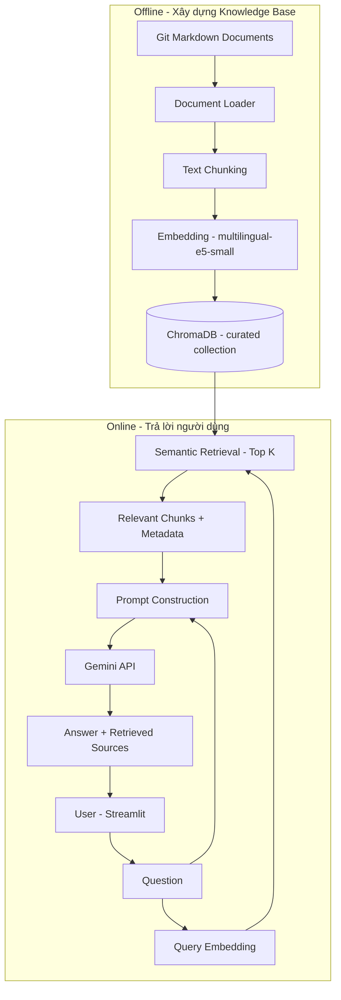

# Git RAG Assistant

> **Chatbot hỏi đáp tài liệu Git bằng Retrieval-Augmented Generation (RAG)**  
> Xây dựng với **Python · Streamlit · ChromaDB · Sentence Transformers · Gemini API**.

Git RAG Assistant hỗ trợ người học và lập trình viên tra cứu các khái niệm, lệnh và tình huống sử dụng Git bằng ngôn ngữ tự nhiên (ưu tiên tiếng Việt). Thay vì chỉ hỏi trực tiếp một mô hình ngôn ngữ, ứng dụng tìm kiếm các đoạn tài liệu Git liên quan trong **Knowledge Base (KB)**, đưa chúng vào ngữ cảnh (context) và yêu cầu Gemini xây dựng câu trả lời dựa trên thông tin được truy xuất.

**Trạng thái:** MVP chạy được trên máy local, đã hoàn thành đánh giá nội bộ với 25 test cases. Dự án được phát triển phục vụ học phần **Chuyên đề công nghệ**.

> [!IMPORTANT]
> Đây là dự án học tập và demo, **không phải tài liệu Git chính thức**. Các câu lệnh có khả năng làm mất dữ liệu như `git reset --hard`, `git clean` hoặc thao tác viết lại lịch sử cần được kiểm tra kỹ trước khi áp dụng trên repository thật.

## Mục lục

- [1. Tính năng](#1-tính-năng)
- [2. Kiến trúc hệ thống](#2-kiến-trúc-hệ-thống)
- [3. Công nghệ sử dụng](#3-công-nghệ-sử-dụng)
- [4. Cấu trúc dự án](#4-cấu-trúc-dự-án)
- [5. Yêu cầu hệ thống](#5-yêu-cầu-hệ-thống)
- [6. Cài đặt và chạy ứng dụng](#6-cài-đặt-và-chạy-ứng-dụng)
- [7. Knowledge Base và quy trình indexing](#7-knowledge-base-và-quy-trình-indexing)
- [8. Hướng dẫn sử dụng](#8-hướng-dẫn-sử-dụng)
- [9. Đánh giá hệ thống](#9-đánh-giá-hệ-thống)
- [10. Các giới hạn hiện tại](#10-các-giới-hạn-hiện-tại)
- [11. Hướng phát triển](#11-hướng-phát-triển)
- [12. Bảo mật và lưu ý khi công khai repository](#12-bảo-mật-và-lưu-ý-khi-công-khai-repository)
- [13. Tài liệu tham khảo](#13-tài-liệu-tham-khảo)

## 1. Tính năng

| Chức năng | Mô tả |
|---|---|
| **Hỏi đáp Git bằng tiếng Việt** | Hỏi về lệnh, khái niệm và cách xử lý tình huống Git thông dụng. |
| **Semantic retrieval** | Tìm các đoạn tài liệu có nội dung liên quan về ngữ nghĩa thay vì chỉ khớp từ khóa. |
| **Grounded answer generation** | Kết hợp context truy xuất và Gemini để tạo câu trả lời. |
| **Tài liệu tham khảo** | Hiển thị danh sách nguồn tài liệu được truy xuất để người dùng tham khảo. |
| **Retrieval Insights** | Quan sát chunk, thứ hạng và cosine distance trong giao diện. |
| **Điều chỉnh Top-K** | Chọn số lượng chunk được truy xuất từ sidebar (1–8; mặc định 4). |
| **Clear Chat** | Xóa hội thoại trong phiên Streamlit hiện tại. |
| **Câu hỏi ngoài phạm vi** | Hướng dẫn mô hình thừa nhận khi context không đủ để trả lời. |
| **Evaluation** | Bộ 25 test cases và script đánh giá Retrieval / Generation. |

**Ví dụ câu hỏi:**

- `git fetch khác git pull như thế nào?`
- `Tôi muốn hoàn tác commit gần nhất nhưng vẫn giữ code trong staging area.`
- `Đã push một commit sai lên nhánh chung, nên dùng reset hay revert?`
- `Cách xử lý merge conflict?`
- `git merge khác git rebase như thế nào?`

## 2. Kiến trúc hệ thống

Dự án sử dụng **Standard / 2-step RAG**: **retrieval trước, generation sau**. Tài liệu được embedding và lập chỉ mục **trước khi** người dùng đặt câu hỏi; ứng dụng không cần tải lại hoặc embedding toàn bộ KB ở mỗi lượt hỏi.



### 2.1. Quy trình indexing (offline)

1. Đọc các file Markdown trong `data/curated/`.
2. Chia tài liệu thành các đoạn (chunks) có overlap để giữ ngữ cảnh.
3. Tạo embedding cho mỗi chunk bằng `intfloat/multilingual-e5-small`; tài liệu sử dụng tiền tố `passage: `.
4. Lưu vector và metadata như tiêu đề, nguồn tham khảo vào ChromaDB trên máy local.

### 2.2. Quy trình hỏi đáp (online)

1. Streamlit nhận câu hỏi người dùng.
2. Tạo embedding câu hỏi với tiền tố `query: `.
3. ChromaDB truy xuất Top-K đoạn có cosine distance thấp nhất.
4. `src/rag_pipeline.py` tổng hợp câu hỏi và các đoạn truy xuất thành context.
5. `src/llm.py` gọi Gemini để sinh câu trả lời bằng tiếng Việt; prompt yêu cầu ưu tiên thông tin trong context và không bịa khi thiếu dữ liệu.
6. Giao diện hiển thị câu trả lời, các nguồn đã truy xuất và thông tin Retrieval Insights.

> **Về sources:** URL hiển thị là metadata nguồn tham khảo của các tài liệu đã được truy xuất. Chúng **không phải trích dẫn đã kiểm chứng độc lập cho từng phát biểu** của mô hình; một tài liệu curated có thể bao gồm nhiều lệnh Git nhưng chỉ gắn một URL tham khảo.

## 3. Công nghệ sử dụng

| Thành phần | Công nghệ | Vai trò |
|---|---|---|
| Ngôn ngữ | Python 3.11 | Xử lý dữ liệu và backend RAG |
| Giao diện | Streamlit | Chat UI và Retrieval Insights |
| Embedding model | `intfloat/multilingual-e5-small` | Biểu diễn ngữ nghĩa tiếng Việt/tiếng Anh |
| Vector database | ChromaDB | Lưu trữ và truy xuất vectors |
| LLM | Gemini API (`google-genai`) | Sinh câu trả lời có điều kiện theo context |
| Text processing | LangChain Text Splitters | Chia tài liệu thành chunks |
| Configuration | `python-dotenv` / `.env` | Nạp cấu hình local |
| Evaluation | Python, JSON, CSV | Chạy test, ghi kết quả và tính metrics |

Ứng dụng dùng **Gemini qua API**, còn embedding được chạy local. Do đó, máy cần Internet để gọi LLM, và có thể cần Internet ở lần đầu tải embedding model.

## 4. Cấu trúc dự án

Cấu trúc *rút gọn*, thể hiện các thành phần chính; số file thực tế có thể khác tùy phiên bản repository.

```text
 git-rag-assistant/
 ├── app.py                       # Streamlit entry point
 ├── src/
 │   ├── document_loader.py      # Nạp curated Markdown documents
 │   ├── vector_store.py         # ChromaDB: indexing & retrieval
 │   ├── rag_pipeline.py         # Retrieval + context + generation
 │   └── llm.py                  # Gemini API integration
 ├── scripts/
 │   ├── reindex_curated.py      # Tạo index cho curated KB
 │   ├── test_retrieval.py       # Kiểm tra truy xuất
 │   ├── test_rag.py             # Kiểm tra end-to-end RAG
 │   ├── create_evaluation_dataset.py
 │   ├── evaluate_retrieval.py
 │   ├── calculate_retrieval_metrics.py
 │   └── evaluate_generation.py
 ├── data/
 │   ├── curated/                # 15 Git Markdown knowledge files
 │   ├── raw/                    # Dữ liệu nguồn nếu được giữ lại
 │   └── processed/              # Tài liệu xử lý trung gian nếu có
 ├── evaluation/
 │   ├── test_questions.json
 │   └── ...                     # CSV và báo cáo đánh giá nếu được commit
 ├── storage/
 │   └── chroma_db/             # Vector database tạo local (không commit)
 ├── .env.example                # Mẫu biến môi trường (không có secret)
 ├── .gitignore
 ├── requirements.txt
 └── README.md
```

> **Lưu ý:** `storage/chroma_db/` và `.env` thường không được đưa lên GitHub. Người clone repository cần tạo `.env` và chạy indexing để tái tạo vector database. Nếu một script hay tài liệu trong cây trên chưa có trong nhánh đã push, hãy đối chiếu với repository thực tế và bỏ mục tương ứng.

## 5. Yêu cầu hệ thống

- **Python 3.11** (phiên bản đã sử dụng khi phát triển: 3.11.9).
- Windows 10/11 + PowerShell (hướng dẫn bên dưới); Linux/macOS có thể chạy với lệnh kích hoạt virtual environment phù hợp.
- RAM khuyến nghị **từ 8 GB**; môi trường phát triển đã kiểm thử dùng **16 GB RAM** và CPU Intel Core i5 thế hệ 12.
- Kết nối Internet cho Gemini API và tải model embedding ở lần đầu.
- **Gemini API key** hợp lệ và quyền sử dụng model cấu hình trong `.env`.

Không yêu cầu GPU riêng cho cấu hình embedding đang sử dụng, nhưng thời gian khởi tạo phụ thuộc phần cứng và trạng thái cache.

## 6. Cài đặt và chạy ứng dụng

### Bước 1 — Clone repository

```powershell
git clone https://github.com/nguyenhai2510/git-rag-assistant.git
cd git-rag-assistant
```


### Bước 2 — Tạo và kích hoạt virtual environment

```powershell
py -3.11 -m venv .venv
.\.venv\Scripts\Activate.ps1
```

Nếu PowerShell chặn việc kích hoạt script, chỉ thay đổi chính sách cho phiên terminal hiện tại:

```powershell
Set-ExecutionPolicy -Scope Process -ExecutionPolicy RemoteSigned
.\.venv\Scripts\Activate.ps1
```

### Bước 3 — Cài đặt dependencies

```powershell
python -m pip install --upgrade pip
python -m pip install -r requirements.txt
```

> `requirements.txt` được tạo từ môi trường phát triển; lần cài đầu có thể mất thời gian để tải các thư viện PyTorch / Sentence Transformers.

### Bước 4 — Cấu hình biến môi trường

Tạo `.env` từ `.env.example`:

```powershell
Copy-Item .env.example .env
```

Kiểm tra và điền các khóa cần thiết, theo cấu hình được dùng trong dự án:

```dotenv
GOOGLE_API_KEY=YOUR_GEMINI_API_KEY
LLM_MODEL=gemini-3.5-flash-lite
EMBEDDING_MODEL=intfloat/multilingual-e5-small
CHROMA_PERSIST_DIR=storage/chroma_db
RETRIEVAL_TOP_K=4
```

- Thay `YOUR_GEMINI_API_KEY` bằng key của bạn.
- Tên model Gemini ở ví dụ là cấu hình **đã dùng khi thực hiện đồ án**, không bảo đảm luôn được cấp quyền ở mọi API project hoặc mọi thời điểm. Nếu model không khả dụng, chọn một model hỗ trợ `generateContent` theo tài khoản của bạn và cập nhật `LLM_MODEL`.
- Nếu không có `.env.example` trong repository, tạo thủ công `.env` theo mẫu trên và bổ sung một `.env.example` **không chứa key thật**.
- **Không commit `.env`, không dán API key vào README, issue hoặc ảnh chụp màn hình.**

### Bước 5 — Tạo vector index từ curated KB

Chạy tại **thư mục gốc** repository:

```powershell
python scripts/reindex_curated.py
```

Trong cấu hình đã được thử nghiệm, bước này lập chỉ mục **15 tài liệu Markdown thành 32 chunks** trong ChromaDB collection `git_documentation_curated`.

Nếu KB, mô hình embedding hoặc chiến lược chunking thay đổi, cần tạo lại index phù hợp. Dữ liệu ChromaDB được lưu local và không bắt buộc lưu trên GitHub.

### Bước 6 — Khởi chạy Streamlit

```powershell
python -m streamlit run app.py
```

Mở trình duyệt tại:

```text
http://localhost:8501
```

### Bước 7 — Kiểm tra nhanh

Nhập câu hỏi: `git fetch khác git pull như thế nào?`

Kỳ vọng ứng dụng hiển thị một câu trả lời giải thích rằng:

- `git fetch` tải dữ liệu từ remote nhưng **không tự động tích hợp** vào nhánh đang làm việc;
- `git pull` lấy dữ liệu và **tiến hành tích hợp** theo cấu hình / tham số (fast-forward, merge hoặc rebase).

Ở sidebar, thử thay đổi **Top-K** rồi xem số đoạn trong **Retrieval Insights**. Nút **Clear Chat** chỉ xóa lịch sử hội thoại của phiên giao diện, **không xóa Knowledge Base hoặc ChromaDB**.

### Khắc phục lỗi thường gặp

| Triệu chứng | Nguyên nhân khả dĩ | Cách xử lý |
|---|---|---|
| `ModuleNotFoundError` | Chưa dùng đúng `.venv` hoặc thiếu package | Kích hoạt `.venv` và cài `requirements.txt` |
| `No module named streamlit` | Streamlit chưa được cài trong môi trường đang chạy | `python -m pip install -r requirements.txt` |
| Truy xuất không có tài liệu | ChromaDB chưa được index hoặc sai collection | Chạy lại `python scripts/reindex_curated.py`; kiểm tra đường dẫn DB |
| Gemini trả `401` / `403` | API key không hợp lệ hoặc chưa đủ quyền | Kiểm tra `.env`, key và quyền model |
| Gemini trả `404` | Model ID không tồn tại / không khả dụng | Kiểm tra danh sách model khả dụng của API project |
| Gemini trả `429 RESOURCE_EXHAUSTED` | Vượt hạn mức request/token | Giảm tốc độ gửi request; dùng retry/backoff theo thời gian API đề nghị |
| Lần đầu mở app lâu | Đang tải/nạp embedding model hoặc cache | Kiểm tra Internet, dung lượng đĩa và tiến trình tải model |

## 7. Knowledge Base và quy trình indexing

### 7.1. Nguồn tài liệu

Knowledge Base được biên soạn và diễn giải lại từ tài liệu Git, tập trung vào các tình huống học Git cơ bản và cộng tác. Các nội dung chính bao gồm:

- Repository, working tree, index (staging area), HEAD.
- `git init`, `git clone`, `git status`, `git add`, `git commit`.
- Branch / switch, merge và giải quyết conflict.
- Remote, fetch, pull, push.
- Log, diff và xem lịch sử thay đổi.
- Các trường hợp undo/recovery: reset, restore, revert.
- Stash, rebase, troubleshooting và command cheatsheet.

Tại thời điểm đánh giá Stage 6:

| Collection | Tài liệu đầu vào | Chunks | Vai trò |
|---|---:|---:|---|
| `git_documentation` | 12 tài liệu Git tham khảo | 271 | Bộ index ban đầu, giữ để thử nghiệm |
| `git_documentation_curated` | 15 Markdown curated | 32 | **Collection sử dụng trong demo và Stage 6** |

**Chưa thực hiện so sánh benchmark định lượng giữa hai collection.** Kết quả đánh giá trong README chỉ áp dụng cho curated collection và `Top-K = 4`.

### 7.2. Embedding và similarity

Embedding model: `intfloat/multilingual-e5-small`. Hệ thống dùng tiền tố phù hợp với E5:

```text
Document text -> "passage: " + content
User question -> "query: " + question
```

Vector được chuẩn hóa để phục vụ truy xuất dựa trên cosine distance. **Cosine distance thấp** thường thể hiện vector gần nhau hơn, nhưng **không bảo đảm** đoạn tài liệu đủ bằng chứng để trả lời; đánh giá còn phụ thuộc nội dung chunk.

### 7.3. Cập nhật Knowledge Base

1. Chỉnh sửa hoặc bổ sung các file Markdown trong `data/curated/`.
2. Kiểm tra metadata nguồn tài liệu và tính chính xác của nội dung.
3. Chạy lại `python scripts/reindex_curated.py` để tái lập index curated.
4. Kiểm thử với các câu hỏi có đáp án tham chiếu trước khi demo.

## 8. Hướng dẫn sử dụng

Ứng dụng sử dụng bố cục hai vùng chính:

- **Chat:** nhập câu hỏi Git, xem câu trả lời và mở phần tài liệu truy xuất.
- **Retrieval Insights:** quan sát Top-K chunks, tiêu đề, nguồn tham khảo, nội dung context và cosine distance.

Sidebar cung cấp thanh điều chỉnh Top-K (mặc định 4) và nút Clear Chat. Lịch sử chat được giữ trong `st.session_state` của phiên trình duyệt hiện tại. **Phiên bản MVP chưa có bộ nhớ hội thoại thực sự trong RAG prompt**: mỗi câu hỏi được xử lý độc lập, không mặc định đưa toàn bộ các lượt chat cũ vào truy vấn tiếp theo.

## 9. Đánh giá hệ thống

### 9.1. Thiết kế thử nghiệm

Bộ đánh giá nội bộ có **25 câu hỏi**:

| Nhóm | Số câu |
|---|---:|
| Git Basics | 5 |
| Branching & Merging | 5 |
| Remote & Collaboration | 5 |
| Undo & Recovery | 5 |
| Edge Cases & Out-of-scope | 5 |
| **Tổng** | **25** |

Trong đó **22 câu thuộc phạm vi KB**, **3 câu ngoài phạm vi** (ví dụ Kubernetes, Spring Boot/MySQL và thời tiết). Retrieval Evaluation dùng `Top-K = 4` với 22 câu trong phạm vi, tạo **88 dòng truy xuất**.

Các metrics được sử dụng:

- **Hit@K:** tỷ lệ câu hỏi có ít nhất một chunk chứa bằng chứng hữu ích trong Top-K.
- **MRR@4:** trung bình nghịch đảo thứ hạng chunk liên quan đầu tiên.
- **Answer Correctness:** chấm 0–2 điểm theo đáp án tham chiếu.
- **Faithfulness:** chấm 0–2 điểm dựa trên mức độ các phát biểu chính được retrieved context hỗ trợ.
- **Out-of-scope Rejection:** chatbot có từ chối phù hợp các yêu cầu ngoài phạm vi hay không.
- **Response Time:** thời gian từ khi gọi `ask_rag()` đến khi nhận kết quả.

### 9.2. Kết quả Stage 6

| Chỉ số | Kết quả | Ghi chú |
|---|---:|---|
| Generation execution | **25/25 thành công** | Sau khi xử lý giới hạn API 429 |
| Retrieval Hit@1 | **77,27%** (17/22) | Nhãn relevance AI đề xuất |
| Retrieval Hit@4 | **95,45%** (21/22) | Nhãn relevance AI đề xuất |
| MRR@4 | **0,8561** | Nhãn relevance AI đề xuất |
| Answer Correctness | **93,18%** (41/44 điểm) | Rubric AI đề xuất |
| Trả lời đạt tối đa Correctness | **20/22** | 20 câu đạt 2/2 |
| Faithfulness | **97,73%** (43/44 điểm) | Đối chiếu hậu nghiệm, AI đề xuất |
| Out-of-scope Rejection | **3/3 PASS** | Nhãn AI đề xuất |
| Thời gian phản hồi trung bình | **3,86 giây** | 25 lượt thành công |
| Thời gian phản hồi trung vị | **1,243 giây** | 25 lượt thành công |

> [!CAUTION]
> **Không diễn giải các con số trên thành độ chính xác tổng quát của hệ thống.** Nhãn relevance, Correctness và Faithfulness được **AI đề xuất**, chưa được người đánh giá độc lập xác nhận. Correctness 93,18% và Faithfulness 97,73% là **điểm rubric chuẩn hóa**, không phải tỷ lệ câu trả lời hoàn toàn đúng hoặc chứng nhận “không hallucination”. Tập thử nghiệm nhỏ và được xây dựng gần với nội dung curated KB, nên có thể lạc quan hơn thực tế.

### 9.3. Phân tích lỗi tiêu biểu

**TC-07 — Liệt kê nhánh Git.** Retrieval không cung cấp đủ thông tin về cách liệt kê nhánh trong Top-4, dẫn tới việc chatbot từ chối một câu hỏi Git hợp lệ. Đây là ví dụ về **Retrieval Miss → Generation Failure**.

**TC-15 — Feature branch workflow.** Câu trả lời có các bước làm việc cơ bản nhưng thiếu push/review theo đáp án tham chiếu: **Incomplete Answer**. Việc câu trả lời có căn cứ không đồng nghĩa với việc đã đủ ý.

**Độ trễ.** Hai trường hợp TC-01 và TC-16 có thời gian cao hơn hẳn các lượt còn lại. Dữ liệu hiện tại không tách riêng thời gian tải model, retrieval và gọi Gemini, nên chưa đủ để khẳng định nguyên nhân.

**Giới hạn nguồn cho Faithfulness.** Tập kết quả generation lưu các URL nguồn, nhưng không snapshot đúng context của từng lần Gemini được gọi; quá trình kiểm tra Faithfulness được thực hiện bằng cách đối chiếu lại các chunks Retrieval đã lưu. Vì thế, kết quả Faithfulness chỉ mang tính tham khảo nội bộ.

### 9.4. Tái chạy đánh giá

```powershell
# 1. Tạo bộ 25 câu hỏi đánh giá (nếu chưa có)
python scripts/create_evaluation_dataset.py

# 2. Truy xuất Top-4 cho các câu in-scope (không gọi Gemini)
python scripts/evaluate_retrieval.py

# 3. Gắn nhãn relevant = 0/1 trong evaluation/retrieval_results.csv
#    trước khi tính các chỉ số
python scripts/calculate_retrieval_metrics.py

# 4. Sinh câu trả lời cho 25 câu (CÓ sử dụng Gemini API quota)
python scripts/evaluate_generation.py
```

**Lưu ý:** Script tính Retrieval Metrics yêu cầu điền cột `relevant` theo từng cặp câu hỏi–chunk. Nếu nhãn chưa được xác nhận, kết quả chỉ mang tính sơ bộ. Generation Evaluation lưu từng case để tránh chạy lại những request đã thành công; cần cân nhắc quota Gemini và rate limiting.

Kết quả chi tiết, nếu được đưa lên repository, nằm trong `evaluation/` (ví dụ `stage6_evaluation_report_v2.md`, `stage6_final_metrics_updated.csv`, `faithfulness_validation_report.md`). Một số file CSV có thể bị `.gitignore` loại trừ; không nên mặc định chúng đã được public.

## 10. Các giới hạn hiện tại

1. **Giới hạn miền kiến thức:** KB được thiết kế cho Git cơ bản và một số tình huống thường gặp; chưa bao phủ toàn bộ tài liệu Git.
2. **Retrieval chưa hoàn hảo:** một số câu hỏi hợp lệ có thể không tìm được bằng chứng trong Top-K; chưa có hybrid search, reranker hoặc truy xuất đa bước.
3. **Chất lượng phụ thuộc curated KB:** biên soạn và gắn metadata có thể thiếu hoặc chưa chính xác cho từng câu lệnh.
4. **Không có conversational memory trong prompt:** các câu hỏi nối tiếp không tự mang ngữ cảnh lượt trước.
5. **Phụ thuộc Gemini API:** cần Internet, key hợp lệ, có thể bị rate limit (`429`), lỗi model hoặc độ trễ mạng.
6. **Đánh giá còn giới hạn:** 25 câu là tập nhỏ; điểm chất lượng do AI đề xuất; chưa có đánh giá độc lập và chưa benchmark đối chiếu hai collections.
7. **Chưa triển khai production:** ứng dụng được thử nghiệm cục bộ; chưa mô tả xác thực người dùng, giám sát, phân quyền hay triển khai quy mô lớn.

## 11. Hướng phát triển

- Bổ sung các nội dung còn thiếu (như `git branch` để liệt kê nhánh), hoàn thiện Git workflows và metadata trích dẫn.
- Thử nghiệm **hybrid retrieval** (semantic + BM25), reranking và đánh giá lại Hit@K trên tập test độc lập.
- Lưu **retrieved context snapshot** trong cùng bản ghi generation để đo Faithfulness tái lập được.
- Phân tách latency của embedding, retrieval, API; thêm retry/backoff theo lỗi quota.
- Hỗ trợ multi-turn question answering có quản lý lịch sử hội thoại.
- Bổ sung test tự động, logging và quy trình triển khai ứng dụng.
- Cân nhắc benchmark giữa **original KB (271 chunks)** và **curated KB (32 chunks)** với cùng tập câu hỏi và tiêu chí chấm.

## 12. Bảo mật và lưu ý khi công khai repository

- **Không bao giờ commit** `.env`, API keys hoặc thông tin xác thực.
- Đảm bảo `.gitignore` loại trừ `.venv/`, cache và `storage/chroma_db/` nếu không có nhu cầu công khai DB.
- Trước khi push, kiểm tra `git status`, `git diff --cached --name-only` và rà soát nội dung staged files.
- Nếu API key từng xuất hiện trong Git history, việc thêm `.gitignore` **không xóa lịch sử cũ**; cần thu hồi/đổi key và xử lý history phù hợp.
- Kiểm tra quyền phân phối tài liệu nguồn và package dependencies nếu dự định công khai dự án lâu dài.
- **Giấy phép (License):** repository chưa được giả định có giấy phép open-source. Nếu muốn cho phép người khác sử dụng, hãy tự chọn và bổ sung file `LICENSE` phù hợp.

## 13. Tài liệu tham khảo

- [Git — Official Documentation](https://git-scm.com/docs)
- [Pro Git Book](https://git-scm.com/book/en/v2)
- [Streamlit Documentation](https://docs.streamlit.io/)
- [ChromaDB Documentation](https://docs.trychroma.com/)
- [Sentence Transformers Documentation](https://sbert.net/)
- [multilingual-e5-small — Model Card](https://huggingface.co/intfloat/multilingual-e5-small)
- [Gemini API Documentation](https://ai.google.dev/gemini-api/docs)
- [LangChain Text Splitters](https://python.langchain.com/docs/concepts/text_splitters/)

---

**Git RAG Assistant** — Dự án thực hành xây dựng ứng dụng hỏi đáp có truy xuất tri thức (Retrieval-Augmented Generation) trên miền tài liệu Git. Phần mềm và kết quả thực nghiệm được cung cấp cho mục đích **học tập, demo và nghiên cứu nội bộ**.
